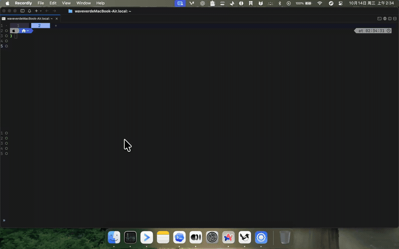

<div align="center">
  

  <h1>buildby</h1>

  <p><strong>Detect what desktop apps are built with.</strong></p>

  <p>
    <a href="https://www.npmjs.com/package/@wavever/buildby"></a>
    <a href="https://github.com/wavever/buildby/releases"></a>
    <a href="https://github.com/wavever/buildby/actions/workflows/release.yml"></a>
    <a href="./LICENSE"></a>
    
    
  </p>

  <p>
    <a href="./README.zh-CN.md">简体中文</a>
    ·
    <a href="#demo">Demo</a>
    ·
    <a href="#quick-start--install">Install</a>
    ·
    <a href="#usage">Usage</a>
    ·
    <a href="#detected-tech-stacks">Tech Stacks</a>
  </p>
</div>

`buildby` inspects desktop applications on macOS, Windows, and Linux, then tells you whether each app is built with **native technologies** (Swift, Objective-C, Win32) or a **cross-platform framework** such as Electron, Flutter, Tauri, Qt, JVM, CEF, NW.js, React Native, wxWidgets, Unity, .NET, Neutralinojs, or Sciter.

It also surfaces **CPU architecture** (Apple Silicon `arm64`, Intel `x86_64`, `universal`), **framework versions**, and **signature & notarization** details.

## Highlights

- Fast file-system and binary header detection with zero admin privileges required.
- Single-app inspection, full installed-app scan, and per-stack filters.
- Native CPU architecture detection (Apple Silicon arm64, Intel x86_64, Universal binary).
- Two-app side-by-side comparison (`buildby compare <app1> <app2>`).
- Interactive fuzzy search mode (`buildby -i`).
- Multiple export formats: formatted terminal report, `--json`, `--markdown`, and `--csv`.
- Signature and notarization metadata for macOS and Windows apps.
- Cross-platform support for macOS, Windows, and Linux (.desktop entries & Flatpak/Snap).

## Demo

<div align="center">
  <a href="./assets/pk-demo.mp4">
    
  </a>
  <p><em>Interactive App Comparison (<code>buildby vs</code> / <code>buildby pk</code>)</em></p>
</div>

## Screenshots

| Inspect a single app | Scan all installed apps | Filter by tech stack |
| :---: | :---: | :---: |
|  |  |  |

## Quick Start & Install

### Run instantly with npx (No install needed)

```bash
npx @wavever/buildby
```

### Global Installation

```bash
# Install globally via npm
npm i -g @wavever/buildby

# Clone and link globally from source
git clone https://github.com/wavever/buildby.git
cd buildby
npm install
npm link

# Or run directly from source
node bin/buildby.js
```

> Previously published as `desktop-app-build-by`. That name is now **deprecated** — please switch to `npm i -g @wavever/buildby`. The CLI command stays `buildby`. See [CHANGELOG.md](./CHANGELOG.md) for details.

### Update

```bash
buildby update           # Check for a newer release and install it
buildby update --check   # Only report whether an update exists
```

`update` asks npm for the latest published version, so your own registry
mirror, proxy and auth settings are respected. When the running copy is a git
checkout or an `npm link`ed build, it reports the path and stops instead of
installing over it.

> Because `update` is a subcommand, an app literally named "update" can no
> longer be inspected by name — use `buildby --path` for that.

## Usage

### Interactive TUI Mode (Default)

Running `buildby` with no arguments in a terminal launches the interactive app browser:

```bash
buildby                  # Launches interactive app browser
buildby -i               # Explicit interactive flag
buildby ui               # Alias
```

- **Keyboard Navigation**: Use `↑` / `↓` arrows to navigate through installed apps, `Enter` to select and inspect an app in detail.
- **Instant Search**: Type any keyword to filter apps in real time.
- **Scrollable Viewport**: Smoothly scroll through all installed apps with pagination indicators (`▲` / `▼` and `[index/total]`).
- **Quick Exit**: Press `q` or `Ctrl+C` to quit anytime.

### Compare two apps (`vs` / `pk`)

Compare the tech stack, binary architecture, size ratio, and code signatures of two apps side by side:

```bash
# Compare specific apps directly
buildby vs "ChatGPT" "Amphetamine"
buildby pk "WeChat" "Discord"
buildby compare "Visual Studio Code" "Sublime Text"

# Or enter interactive multi-select comparison mode
buildby vs
# → Browse with ↑/↓, press Space to select 2 apps, press Enter to compare!
```

### Inspect a single app

```bash
buildby wechat
buildby discord
buildby "visual studio code"
buildby "clash verge"
```

Output example:

```
  Discord
  /Applications/Discord.app

   CROSS-PLATFORM   ⚡ Electron

  Cross-platform desktop apps with web technologies (HTML/CSS/JS)
  https://www.electronjs.org

  Evidence:
    • Electron Framework.framework
    • app.asar

  Bundle ID: com.hnc.Discord
  Version:   0.0.335
  Size:      375.4 MB

  Signature & Notarization
    Developer:        Discord, Inc.
    Team ID:          53Q6R32WPB
    Signature:        Signed
    Notarization:     Notarized
    Hardened Runtime: ✓ Yes
```

> The **Signature & Notarization** section is only printed for single-app inspection (`buildby <name>` and `--path`). `--all` and `--<stack>` skip it so batch scans stay fast.

### Scan all installed apps

```bash
buildby --all
buildby -a
```

Scans all apps in `/Applications` (macOS) or `Program Files` (Windows) and groups them by tech stack with a distribution chart.

> `--scan` is still supported as a legacy alias for `--all`.

Batch scans use a local analysis cache. If an app's version and main executable fingerprint have not changed, BuildBy reuses the previous result so repeated scans are nearly instant.

```bash
buildby --all --no-cache   # Force a fresh analysis
```

### Export Formats

#### Markdown Table (`--markdown` / `--md`)

Export results as a GitHub Flavored Markdown table, complete with tech stack metadata and an overall distribution summary:

```bash
buildby --all --md > installed-apps.md
buildby discord --md
```

#### CSV Table (`--csv`)

Export results to an RFC 4180 compliant CSV spreadsheet ready for Excel, Numbers, or data analysis:

```bash
buildby --all --csv > installed-apps.csv
```

#### JSON Output (`--json`)

Add `--json` to any inspection mode to get machine-readable output on stdout
(`update` is an action command and has no JSON form). Progress and
errors stay on stderr, so stdout is always safe to pipe.

```bash
buildby discord --json
buildby --all --json | jq '.summary.stacks'
buildby --electron --json | jq -r '.apps[].name'
```

Every mode returns the same envelope, so consumers never branch on shape:

```json
{
  "schema": 1,
  "buildbyVersion": "1.4.0",
  "platform": "darwin",
  "query": { "mode": "app", "value": "calibre" },
  "apps": [
    {
      "name": "calibre",
      "stack": "python",
      "stackName": "Python (PyQt)",
      "variant": "PyQt",
      "category": "cross-platform",
      "confidence": "high",
      "evidence": ["Python.framework", "PyQt UI toolkit"],
      "bundleId": "net.kovidgoyal.calibre",
      "version": "7.22.0",
      "sizeBytes": 1052946432
    }
  ],
  "summary": null
}
```

Notes for consumers:

- **`stack` is the stable identifier** — key on it, not on `stackName`. `stackName` is a display label and `variant` carries the sub-technology (`PyQt`, `Rust · AppKit`).
- **`evidence` is human-oriented** and not a stable API. Do not parse it.
- Sizes are raw bytes; no localized text appears in JSON output.
- `summary` is populated for `--all` only; it is `null` elsewhere.
- Signature and notarization are collected for single-app modes only, matching the report behaviour, so they are `null` under `--all`.
- `schema` is versioned — check it before trusting field semantics.

Exit codes (applied under `--json` only, so existing usage is unaffected):

| Code | Meaning |
| ---- | ------- |
| `0`  | At least one app matched |
| `1`  | No apps matched (payload still valid, `apps: []`) |
| `2`  | Error — unsupported platform, missing path, analysis failure |

On error, stdout carries a parseable error object instead of `apps`:

```json
{ "schema": 1, "error": { "code": "path_not_found", "message": "Path not found: /nope" } }
```

### Configuration

BuildBy creates a default JSON config file on first run, then reads it on later runs:

- macOS/Linux/other: `$XDG_CONFIG_HOME/buildby/config.json` or `~/.config/buildby/config.json`
- Windows: `%APPDATA%\buildby\config.json`

On macOS, existing configs from `~/.buildby/config.json` are copied to the new XDG path automatically when the new file does not exist.

You can also point to a custom config file with `BUILDBY_CONFIG=/path/to/config.json`; BuildBy will create that file with defaults if it does not exist.

```json
{
  "cache": true,
  "excludeApps": [
    "Xcode",
    "com.apple.Safari",
    "/Applications/VMware Fusion.app"
  ]
}
```

`cache: false` disables the analysis cache by default. `excludeApps` removes matching apps from `--all` and per-stack scans; entries can be app names, Bundle IDs, or full paths. Single-app inspection still works for excluded apps.

### Language

BuildBy follows your terminal or system language by default. To show English output without changing system language:

```bash
LC_ALL=en_US.UTF-8 buildby -a
```

You can also create an alias:

```bash
alias buildby-en='LC_ALL=en_US.UTF-8 buildby'
```

### Filter by tech stack

```bash
buildby -e     # All Electron apps (--electron)
buildby -f     # All Flutter apps (--flutter)
buildby -t     # All Tauri apps (--tauri)
buildby -q     # All Qt apps (--qt)
buildby -j     # All JVM apps (--jvm)
buildby -c     # All CEF apps (--cef)
buildby -d     # All .NET / MAUI / WPF apps (--dotnet)
buildby -b     # All Chromium apps (--chromium)
buildby -W     # All NW.js apps (--nwjs)
buildby -r     # All React Native apps (--reactnative)
buildby -w     # All wxWidgets apps (--wxwidgets)
buildby -u     # All Unity apps (--unity)
buildby -n     # All native apps (--native)
```

### Inspect a custom path

```bash
buildby --path /Applications/SomeApp.app
buildby --path "C:\Program Files\SomeApp"
```

## Detected Tech Stacks

| Stack                        | Description                       | Detection Method                                          |
| ---------------------------- | --------------------------------- | --------------------------------------------------------- |
| ⚡ **Electron**               | Node.js + Chromium                | `Electron Framework.framework`, `app.asar`, framework version extraction |
| 🐦 **Flutter**               | Google's UI toolkit               | `FlutterMacOS.framework`, `flutter_windows.dll`, framework version |
| 🌐 **CEF**                   | Chromium Embedded Framework       | `Chromium Embedded Framework.framework`, `libcef.dll`     |
| 🌐 **Chromium**              | Built directly on Chromium        | `.pak` packs + V8 snapshot (Qt WebEngine excluded)        |
| 🟩 **NW.js**                 | Node.js + Chromium (node-webkit)  | `nwjs Framework.framework`, `app.nw`                      |
| ⚛️ **React Native**          | Facebook's React for desktop      | `React.framework`, `hermes.dll`                           |
| 🦀 **Tauri**                 | Rust + system WebView             | Tauri crate markers in binary, v1/v2 variant, `WebView2Loader.dll` |
| ⚡ **Neutralinojs**          | Lightweight HTML/JS desktop app   | `neutralino.js`, `neutralino.config.json`, binary signatures |
| 🐹 **Wails**                 | Go + system WebView               | `github.com/wailsapp/wails` in binary                     |
| 🔷 **Qt**                    | C++ cross-platform                | `Qt*.framework` (incl. nested), `Qt5Core.dll` / `Qt6Core.dll`, Qt version |
| 🟫 **GTK**                   | GNOME widget toolkit              | `libgtk-3/4.dylib`, `libgtk-3-0.dll`                      |
| 🧩 **wxWidgets**             | C++ wrapper over native widgets   | `libwx*.dylib`, `wxmswXXu_*.dll`                          |
| 🧩 **Sciter**                | Embeddable HTML/CSS engine        | `sciter.dll`, `libsciter.dylib`, binary signatures        |
| 🎵 **JUCE**                  | C++ audio apps and plug-in hosts  | `JUCE v` / `juce::` markers in binary                     |
| 🐍 **Python**                | py2app / PyInstaller / CPython    | `__boot__.py`, `base_library.zip`, `Python.framework`     |
| ☕ **JVM**                    | Java/Kotlin/Scala                 | `jbr/`, `libjvm.dylib`, `.jar` in `lib/` `app/` `Java/`   |
| 🟣 **Compose Multiplatform** | Kotlin UI via Skia                | `libskiko-macos-*.dylib`, `skiko-awt-runtime-*.jar`       |
| 🔵 **.NET**                  | Microsoft .NET / MAUI / WPF       | `MonoBundle/`, `coreclr.dll`, `.dll` files                |
| 🦅 **Avalonia**              | Cross-platform .NET UI            | `Avalonia*.dll`, `libAvalonia*`                           |
| 🎮 **Unity**                 | Unity game engine                 | `UnityPlayer.dll`, `Data/` layout                         |
| 🎯 **Unreal Engine**         | Epic UE4 / UE5                    | `Content/Paks/*.pak`, `Contents/UE5/`                     |
| 🤖 **Godot**                 | Godot game engine                 | `*.pck` archive + engine marker in binary                 |
| 🖥️ **Native**               | Platform-native technologies      | Fallback; reports Swift / Objective-C / Rust / Go         |

## Platform Support

| Platform | App Discovery                                                    | Detection                                  |
| -------- | ---------------------------------------------------------------- | ------------------------------------------ |
| macOS    | `/Applications`, `~/Applications`                                | Framework bundles, in-process Mach-O parser, `Info.plist` |
| Windows  | `Program Files`, `Program Files (x86)`, `AppData/Local/Programs` | PE header inspection, DLL signatures, directory structure |
| Linux    | `/usr/share/applications`, `~/.local/share/applications`, Flatpak, Snap | `.desktop` entries, ELF headers, shared library markers |

## How It Works

Detection is fast, secure, and purely **file-system and binary header based** — zero admin privileges required.

1. **Framework directory & DLL scan** — check `Contents/Frameworks/` (macOS), root directories (Windows/Linux), or linked libraries for known frameworks (Electron, Flutter, CEF, Qt, GTK, etc.).
2. **Binary header inspection** — pure JavaScript streaming parser inspects Mach-O load commands (`LC_LOAD_DYLIB`), Universal/Fat binaries, PE architectures, and ELF headers with zero subprocess overhead.
3. **Resource file patterns** — look for `app.asar`, `flutter_assets`, `neutralino.js`, `app.nw`, etc.
4. **Runtime & Framework versions** — extracts runtime versions from Electron (`package.json` / version files), Flutter framework strings, and Qt dylibs.
5. **JVM & Game Engine detection** — detect bundled JRE/JBR runtimes, `.jar` files, Unity Data, Unreal Engine pak files, and Godot pck archives.
6. **Metadata extraction** — parse macOS `Info.plist`, Windows version resources, and Linux `.desktop` entries for display name, version, and bundle ID.
7. **Signature & notarization** — invoke `codesign -dv` + `spctl --assess` on macOS, or PowerShell `Get-AuthenticodeSignature` on Windows, to surface developer, Team ID, publisher, and Apple notarization or Authenticode trust status.
8. **Smart caching** — hashes binary fingerprints and versions so repeated batch scans run near-instantaneously.
9. **Native fallback** — apps with no cross-platform framework signatures are classified as Native (Swift / Objective-C / Rust / Go / C++ / Win32).

Detection runs in priority order so the most distinctive signatures are checked first.

## Requirements

- Node.js >= 18
- macOS, Windows, or Linux
- macOS: Xcode Command Line Tools (for `codesign` and `spctl` signature inspection)
- Windows: PowerShell on `PATH` (for Authenticode signature reading)
- Linux: Standard FreeDesktop / XDG desktop environment

## License

MIT
